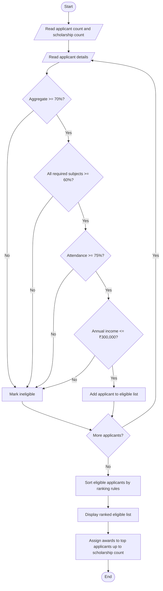

# University Scholarship Allocation System

## Problem Statement
University Scholarship Allocation: Design a system that evaluates applicants using aggregate
marks, subject-wise minimum scores, attendance, and income criteria, ranks eligible students, and
resolves ties using predefined rules.


## Algorithm

1. Read the number of applicants and the number of scholarships available.
2. For each applicant, read their name, aggregate marks, subject marks, attendance, and annual family income.
3. Check whether the applicant meets every eligibility requirement.
4. Store eligible applicants and their ranking details.
5. Sort eligible applicants by aggregate marks (descending), attendance (descending), income (ascending), then name (ascending).
6. Display the ranked list.
7. Award scholarships to the first applicants in the ranking, up to the available number of scholarships.

## Flowchart




## Sample Input

Enter the following values when prompted:

```text
4
2
Asha
85
80
78
82
90
250000
Bharat
85
75
70
80
85
200000
Charan
68
75
72
80
95
150000
Divya
91
58
90
88
92
100000
```

The subject marks are entered in this order: Mathematics, Science, English.

## Sample Output

```text
Ranked Eligible Applicants
1. Asha | Aggregate: 85.0% | Attendance: 90.0% | Income: ₹250,000 | Awarded
2. Bharat | Aggregate: 85.0% | Attendance: 85.0% | Income: ₹200,000 | Awarded
```

Charan is ineligible because aggregate marks are below 70%. Divya is ineligible because Mathematics is below the 60% subject minimum.
