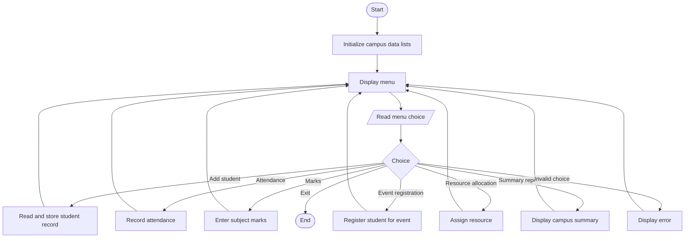

# Comprehensive Smart Campus Management Simulation

## Problem Statement
Comprehensive Smart Campus Management Simulation: Develop a menu-driven program that
integrates student records, attendance, marks, event registration, resource allocation, and summary
reporting using conditional statements, loops, strings, lists, nested lists, tuples, and tuple unpacking.
## Algorithm

1. Initialize lists for students, events, resources, and attendance.
2. Display the menu repeatedly until the user chooses Exit.
3. Process the selected menu option:
   - **Add student:** store ID, name, and course.
   - **Record attendance:** store a student ID and attendance status for a day.
   - **Enter marks:** store subject marks for a student.
   - **Register for event:** add a student ID to an event’s registration list.
   - **Allocate resource:** assign a resource to a student.
   - **Summary report:** display student, attendance, marks, event, and resource summaries.
4. Validate IDs and inputs before updating records.
5. Repeat the menu after each operation; exit when requested.

## Flowchart




## Sample Input

The following shows the sequence of menu choices and responses:

```text
1
S101
Asha Rao
Computer Science
2
S101
2026-10-30
P
3
S101
Python
92
4
S101
E101
5
S101
R101
6
0
```

## Sample Output

```text
Student Asha Rao added.
Attendance recorded for Asha Rao.
Mark recorded for Python.
Registered for Tech Fest.
Projector allocated to S101.

--- Campus Summary ---
Students: 1
S101 | Asha Rao | Computer Science
  Marks: Python: 92

Attendance:
S101: 1/1 present (100.0%)

Events:
E101 | Tech Fest | 1 registered
E102 | Cultural Day | 0 registered

Resources:
R101 | Projector | Allocated
R102 | Laptop | Available
R103 | Lab Seat | Available

Resource allocations: 1

Exiting Smart Campus Management.
```
