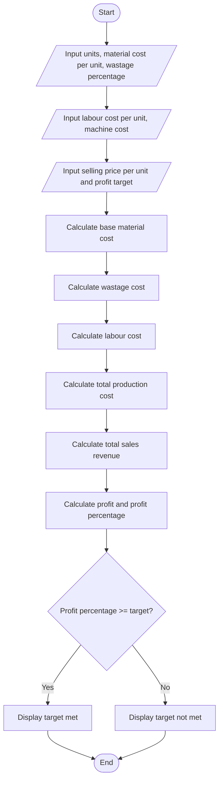

# Manufacturing Cost and Profitability Analysis

## Problem Statement
 Manufacturing Cost and Profitability Analysis: Calculate material costs, labour charges, wastage,
machine costs, and selling prices; identify whether production meets a specified profit target.
## Algorithm

1. Read the number of units to produce.
2. Read material cost per unit, wastage percentage, labour cost per unit, and total machine cost.
3. Read selling price per unit and the required profit target percentage.
4. Calculate base material cost: `units × material cost per unit`.
5. Calculate wastage cost: `base material cost × wastage percentage ÷ 100`.
6. Calculate labour cost: `units × labour cost per unit`.
7. Calculate total production cost by adding material, wastage, labour, and machine costs.
8. Calculate total sales revenue: `units × selling price per unit`.
9. Calculate profit and profit percentage.
10. Compare the profit percentage with the target and display the result.

## Flowchart




## Sample Input

```text
Number of units to produce: 100
Material cost per unit: ₹200
Material wastage percentage: 5
Labour cost per unit: ₹80
Total machine cost: ₹5000
Selling price per unit: ₹400
Required profit target (%): 20
```

## Sample Output

```text
Cost and Profit Report
Base material cost:    ₹20,000.00
Wastage cost:          ₹1,000.00
Total material cost:   ₹21,000.00
Total labour cost:     ₹8,000.00
Machine cost:          ₹5,000.00
Total production cost: ₹34,000.00
Total sales revenue:   ₹40,000.00
Profit:                ₹6,000.00
Profit percentage:     17.65%
Result: Profit target of 20.00% not met.
```
