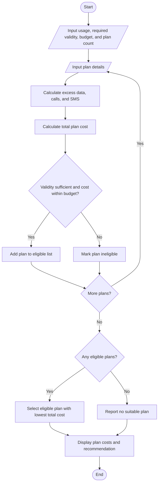

# Multi-Plan Telecommunications Cost Optimization

## Problem Statement
Multi-Plan Telecommunications Cost Optimization: Evaluate several mobile plans against usage,
validity, and budget constraints; calculate excess charges and identify the most economical eligible
plan.
## Algorithm

1. Read the user’s data, call, and SMS requirements, required validity, budget, and number of plans.
2. For each plan, read its allowances, base price, validity, and excess rates.
3. Calculate excess data, call minutes, and SMS.
4. Calculate the plan’s total cost by adding its base price and excess charges.
5. Mark a plan eligible if its validity meets the requirement and its total cost is within the budget.
6. Select the eligible plan with the lowest total cost.
7. Display each plan’s cost and eligibility, then show the recommended plan or report that none qualify.

## Flowchart




## Sample Input

```text
Required data (GB): 20
Required call minutes: 300
Required SMS count: 100
Required validity (days): 28
Budget (₹): 500
Number of plans to compare: 3

Plan 1
Plan name: Basic
Included data (GB): 15
Included call minutes: 300
Included SMS count: 100
Base price (₹): 250
Validity (days): 28
Charge per excess GB (₹): 20
Charge per excess call minute (₹): 0.5
Charge per excess SMS (₹): 1

Plan 2
Plan name: Value
Included data (GB): 20
Included call minutes: 300
Included SMS count: 100
Base price (₹): 399
Validity (days): 56
Charge per excess GB (₹): 20
Charge per excess call minute (₹): 0.5
Charge per excess SMS (₹): 1

Plan 3
Plan name: Premium
Included data (GB): 30
Included call minutes: 500
Included SMS count: 200
Base price (₹): 599
Validity (days): 56
Charge per excess GB (₹): 10
Charge per excess call minute (₹): 0.25
Charge per excess SMS (₹): 0.5
```

## Sample Output

```text
Plan Comparison
Basic: total ₹350.00 | Excess: 5.00 GB data, 0 call minutes, 0 SMS | Eligible
Value: total ₹399.00 | Excess: 0.00 GB data, 0 call minutes, 0 SMS | Eligible
Premium: total ₹599.00 | Excess: 0.00 GB data, 0 call minutes, 0 SMS | Not eligible

Most economical eligible plan: Basic (₹350.00)
```
