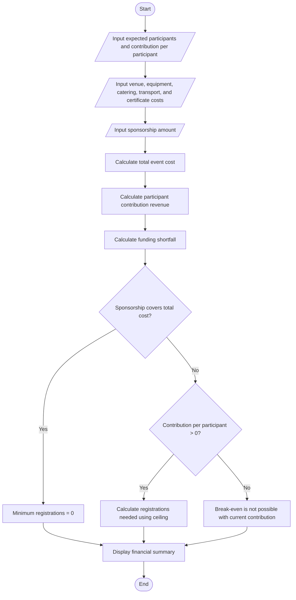

# Campus Event Financial Planning

## Problem Statement

Create a Python program to estimate the cost of a campus event, including venue, equipment, catering, transport, and certificates. Calculate the total event cost, the amount participants must contribute after sponsorship, any sponsorship shortfall, and the minimum number of registrations needed to break even.

**Assumption:** Sponsorship is a fixed amount. Each registered participant pays the same contribution. The event breaks even when participant contributions plus sponsorship cover the total cost.

## Algorithm

1. Read the number of expected participants and the contribution per participant.
2. Read the costs for venue, equipment, catering, transport, and certificates.
3. Read the sponsorship amount.
4. Calculate total event cost by adding all five cost categories.
5. Calculate participant contribution revenue: `participants × contribution per participant`.
6. Calculate the funding shortfall: `max(0, total cost − sponsorship − participant revenue)`.
7. Calculate the minimum registration count needed to break even:
   - If sponsorship covers the total cost, the minimum is 0.
   - Otherwise, divide the remaining cost by the contribution per participant and round up.
8. Display the cost breakdown, revenue, shortfall, and break-even count.

## Flowchart




## Sample Input

```text
Expected number of participants: 100
Contribution per participant (₹): 300
Venue cost (₹): 12000
Equipment cost (₹): 8000
Catering cost (₹): 18000
Transport cost (₹): 7000
Certificate cost (₹): 5000
Sponsorship amount (₹): 15000
```

## Sample Output

```text
Event Cost Breakdown
Venue:                 ₹12,000.00
Equipment:             ₹8,000.00
Catering:              ₹18,000.00
Transport:             ₹7,000.00
Certificates:          ₹5,000.00
Total event cost:      ₹50,000.00
Sponsorship:           ₹15,000.00
Participant revenue:   ₹30,000.00
Funding shortfall:     ₹5,000.00
Surplus:               ₹0.00
Break-even registrations: 117
```
