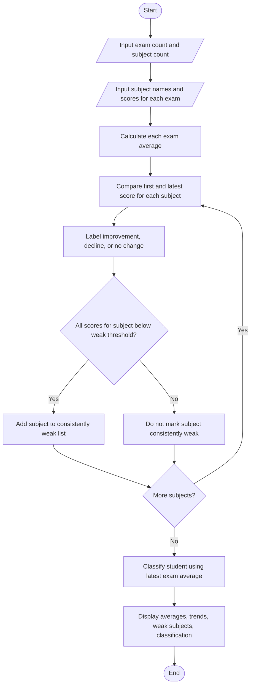

# Student Performance Trend Analysis

## Problem Statement
 Student Performance Trend Analysis: Compare assessment scores across multiple examinations,
calculate improvements and declines, identify consistently weak subjects, and classify students
according to defined criteria.


## Algorithm

1. Read the number of examinations and subjects.
2. Read each subject’s score for every examination.
3. Calculate the average score for each examination.
4. For each subject:
   - Calculate the score change from the first to the latest examination.
   - Label the trend as improvement, decline, or no change.
   - Mark the subject weak if all its scores are below the weak-subject threshold.
5. Classify the student using the latest examination average.
6. Display examination averages, subject trends, weak subjects, and classification.

## Flowchart




## Sample Input

```text
Number of examinations: 3
Number of subjects: 4

Subject name: Mathematics
Score in Exam 1 (0-100): 35
Score in Exam 2 (0-100): 38
Score in Exam 3 (0-100): 39

Subject name: Science
Score in Exam 1 (0-100): 60
Score in Exam 2 (0-100): 65
Score in Exam 3 (0-100): 70

Subject name: English
Score in Exam 1 (0-100): 72
Score in Exam 2 (0-100): 68
Score in Exam 3 (0-100): 66

Subject name: History
Score in Exam 1 (0-100): 50
Score in Exam 2 (0-100): 55
Score in Exam 3 (0-100): 60
```

## Sample Output

```text
Examination Averages
Exam 1: 54.25%
Exam 2: 56.50%
Exam 3: 58.75%

Subject Trends
Mathematics: 35.0 -> 39.0 | Improved by 4.0 points | Consistently weak
Science: 60.0 -> 70.0 | Improved by 10.0 points
English: 72.0 -> 66.0 | Declined by 6.0 points
History: 50.0 -> 60.0 | Improved by 10.0 points

Consistently Weak Subjects
Mathematics

Student Classification: Needs Improvement
```
