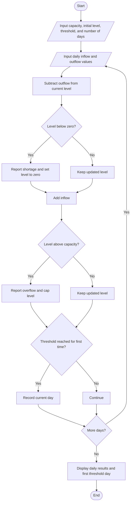

# Multi-Day Water Tank Simulation

## Problem Statement
Multi-Day Water Tank Simulation: Process changing inflow and outflow quantities, update
water levels, detect overflow and shortages, and determine the first interval in which the tank reaches
a specified threshold.
## Algorithm

1. Read tank capacity, initial water level, and target threshold.
2. Read the number of days and each day’s inflow and outflow.
3. For each day:
   1. Subtract outflow from the current level.
   2. If the result is below zero, report a shortage and set the level to zero.
   3. Add inflow.
   4. If the result exceeds capacity, report overflow and cap the level at capacity.
   5. If the threshold has not previously been reached and the level is at least the threshold, record this day.
4. Display the daily results and the first day the threshold was reached, or report that it was never reached.

## Flowchart




## Sample Input

```text
Tank capacity (litres): 1000
Initial water level (litres): 500
Target threshold (litres): 800
Number of days: 4

Day 1
Inflow (litres): 200
Outflow (litres): 100

Day 2
Inflow (litres): 500
Outflow (litres): 100

Day 3
Inflow (litres): 100
Outflow (litres): 300

Day 4
Inflow (litres): 100
Outflow (litres): 900
```

## Sample Output

```text
Daily Simulation Results
Day | Inflow | Outflow | Final Level | Status
----------------------------------------------------------
  1 |  200.0 |   100.0 |       600.0 | Normal
  2 |  500.0 |   100.0 |      1000.0 | OVERFLOW
  3 |  100.0 |   300.0 |       800.0 | Normal
  4 |  100.0 |   900.0 |       100.0 | Normal

The tank first reached the threshold of 800.0 litres on Day 2.
```
