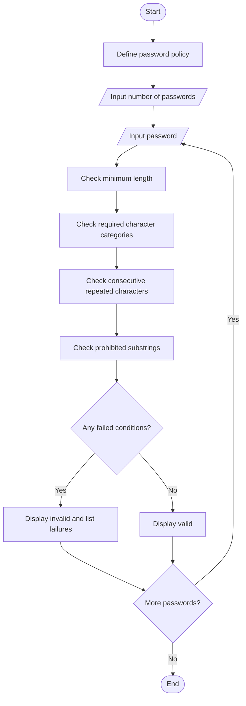

# Password Policy Validation Engine

## Problem Statement

Password Policy Validation Engine: Evaluate sample password strings against minimum length,
character-category, repetition, and prohibited-substring rules; explain each failed condition.

## Algorithm

1. Define the password policy: minimum length, required character categories, repetition limit, and prohibited substrings.
2. Read the number of passwords to check.
3. For each password:
   1. Check whether its length meets the minimum.
   2. Check whether each required character category is present.
   3. Scan for consecutive runs of the same character longer than the allowed limit.
   4. Check whether any prohibited substring occurs, ignoring case.
   5. Collect and display all failed conditions.
4. Mark a password as valid if no conditions failed.

## Flowchart




## Sample Input

```text
Number of passwords to check: 3

Password 1: Abc@1234
Password 2: GoodPass9!
Password 3: aaA1!xyz
```

## Sample Output

```text
Password Policy Validation Engine

Result for Password 1: Invalid
Failed conditions:
- Must not contain prohibited substring(s): 1234.

Result for Password 2: Invalid
Failed conditions:
- Must not contain prohibited substring(s): password.

Result for Password 3: Valid
```
