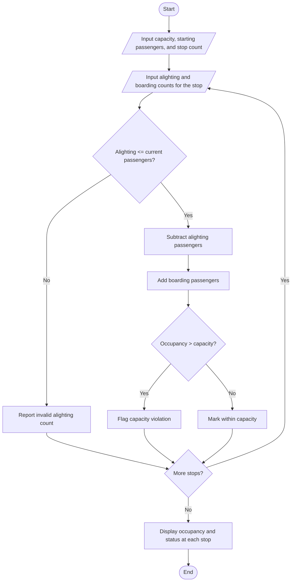

# Bus Passenger Occupancy Simulation

## Problem Statement
 Bus Passenger Occupancy Simulation: Process boarding and alighting counts across multiple
stops, calculate passenger counts at each stop, and flag any capacity violations.
## Algorithm

1. Read the bus capacity, starting passenger count, and number of stops.
2. For each stop, read the number of passengers alighting and boarding.
3. Check that alighting does not exceed the current passenger count.
4. Subtract alighting passengers, then add boarding passengers.
5. Compare occupancy with bus capacity and flag any violation.
6. Display the occupancy and status at each stop.

## Flowchart




## Sample Input

```text
Bus capacity: 50
Passengers on bus before first stop: 35
Number of stops: 3

Stop 1
Passengers alighting: 10
Passengers boarding: 15

Stop 2
Passengers alighting: 5
Passengers boarding: 20

Stop 3
Passengers alighting: 25
Passengers boarding: 8
```

## Sample Output

```text
Occupancy by Stop
Stop | Alighted | Boarded | Passengers | Status
--------------------------------------------------------------
   1 |       10 |      15 |         40 | Within capacity
   2 |        5 |      20 |         55 | CAPACITY VIOLATION
   3 |       25 |       8 |         38 | Within capacity
```
