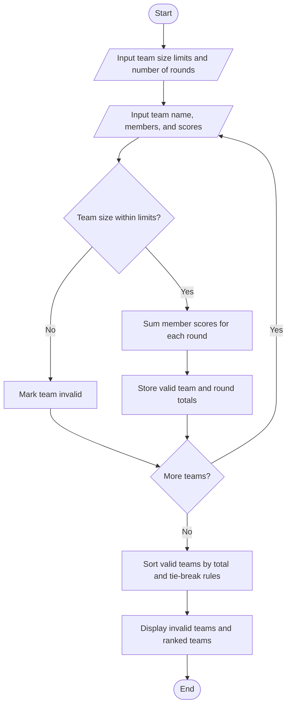

# Hackathon Team Formation and Ranking

## Problem Statement

Hackathon Team Formation and Ranking: Analyse student scores and team compositions,
validate team sizes, aggregate round-wise scores, and resolve tied rankings using predefined rules.

## Algorithm

1. Read the minimum and maximum allowed team size, and the number of scoring rounds.
2. For each team, read its name, member names, and each member’s score for every round.
3. Validate that the team size is within the allowed range.
4. For each valid team, sum member scores round by round to get team round totals.
5. Sort valid teams by:
   - Total score across all rounds, descending.
   - Final-round score, descending.
   - Earlier round scores from latest to earliest, descending.
   - Team name, alphabetical order.
6. Display invalid teams and the ranked valid teams.

## Flowchart




## Sample Input

```text
Minimum team size: 2
Maximum team size: 4
Number of scoring rounds: 2
Number of teams: 3

Team name: CodeCrafters
Number of team members: 2
Member 1 name: Asha
Asha score in Round 1: 40
Asha score in Round 2: 45
Member 2 name: Ravi
Ravi score in Round 1: 35
Ravi score in Round 2: 40

Team name: ByteBuilders
Number of team members: 3
Member 1 name: Mina
Mina score in Round 1: 30
Mina score in Round 2: 40
Member 2 name: Omar
Omar score in Round 1: 35
Omar score in Round 2: 35
Member 3 name: Leah
Leah score in Round 1: 45
Leah score in Round 2: 20

Team name: SoloSpark
Number of team members: 1
Member 1 name: Dev
Dev score in Round 1: 50
Dev score in Round 2: 50
```

## Sample Output

```text
Invalid Teams
SoloSpark: 1 members (allowed size: 2-4)

Team Rankings
1. CodeCrafters | Total: 160 | Round 1: 75, Round 2: 85
2. ByteBuilders | Total: 160 | Round 1: 110, Round 2: 95
```

Correction: With the stated tie-break rule, **ByteBuilders ranks first** because its final-round score is higher (95 vs. 85). The correctly ordered ranking is:

```text
Team Rankings
1. ByteBuilders | Total: 255 | Round 1: 110, Round 2: 95
2. CodeCrafters | Total: 160 | Round 1: 75, Round 2: 85
```
